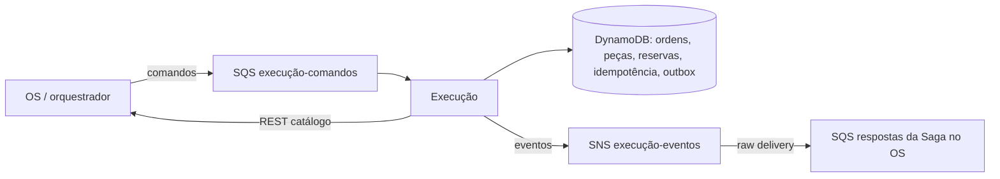

# Execução

Microsserviço de diagnóstico, prestações, fila de execução e estoque da oficina. É dono de cinco tabelas DynamoDB. Recebe comandos da Saga orquestrada pelo serviço OS em SQS e publica eventos em SNS por meio de outbox. Não acessa bancos dos outros serviços; consulta o catálogo de serviços do OS por REST.

`AbrirDiagnostico` cria a execução e grava `DiagnosticoAberto` na outbox transacional. Comandos duplicados são tratados por `messageId`. O serviço também consome `ReservarPecas`, `LiberarReservaPecas` e `IniciarExecucao`. Falta de estoque produz `ReservaPecasRecusada`; conflitos transitórios permanecem na fila para nova tentativa. A compensação da Saga para orçamento recusado ou expirado é solicitada pelo OS por `LiberarReservaPecas`.

## Executar

Java 21 e Maven Wrapper: `./mvnw.cmd verify` no Windows ou `./mvnw verify` no Linux. Configure `AWS_REGION`, `EXECUCAO_ORDENS_TABLE`, `EXECUCAO_IDEMPOTENCIA_TABLE`, `EXECUCAO_OUTBOX_TABLE`, `EXECUCAO_PECAS_TABLE`, `EXECUCAO_RESERVAS_TABLE`, `EXECUCAO_COMMAND_QUEUE_URL` e `EXECUCAO_EVENT_TOPIC_ARN`. Para LocalStack, defina `AWS_ENDPOINT` e credenciais de teste. Para construir a imagem, rode `./mvnw.cmd package` e `docker build -t mecanica-execucao .`.

No Windows, com Docker Desktop e AWS CLI instalados, execute `. .\scripts\setup-localstack.ps1` a partir da raiz do repositório. Na mesma sessão, rode `.\mvnw.cmd spring-boot:run`. Em outra sessão, execute `.\scripts\demo-localstack.ps1`. O script reproduz abertura idempotente de diagnóstico, reserva e eventos entregues à fila de respostas simulada. Veja [o roteiro e as evidências](docs/evidencias-f6.md).

O endpoint `GET /actuator/health` verifica a aplicação; `GET /execucoes/{osId}` consulta o diagnóstico. O contrato REST gerado está em `GET /v3/api-docs` e pode ser explorado em `GET /swagger-ui.html`. A fila de comandos deve ser padrão e ter DLQ; a assinatura do tópico na fila de respostas da Saga deve usar entrega bruta.

## Diagnóstico e prestações

Configure `EXECUCAO_OS_BASE_URL` para validar e guardar o nome do serviço a partir de `GET /servicos/{id}` no serviço OS (cache local de 5 minutos). As peças de `execucao-pecas` precisam de `valorUnitario` para formar o snapshot do orçamento.

Durante `EM_DIAGNOSTICO`, use `POST /execucoes/{osId}/prestacoes` com `{ "servicoId": "UUID", "precoMdo": 80.00 }`, `POST /execucoes/{osId}/prestacoes/{id}/pecas` com `{ "pecaId": "UUID", "qtd": 2 }`, `PATCH /prestacoes/{id}/inativar` ou `PATCH /alocacoes/{id}/inativar`. `PATCH /execucoes/{osId}/diagnostico/concluir` exige ao menos uma prestação ativa e grava `DiagnosticoConcluido` na outbox junto da transição para `AGUARDANDO_APROVACAO`.

O cadastro de peças usa `POST /pecas` e `PUT /pecas/{id}` com `{ "nome": "Filtro", "descricao": "Filtro de óleo", "valorUnitario": 29.90, "qtdEstoque": 1 }`. `GET /pecas` e `GET /pecas/{id}` retornam também `qtdDisponivel` e `qtdReservada`. A criação responde 201 com `Location`; alterações incompatíveis com uma reserva respondem 409.

O comando `IniciarExecucao` confirma a reserva e muda a execução para `EM_EXECUCAO`, iniciando as prestações ativas. `PATCH /prestacoes/{id}/finalizar` conclui uma prestação; a última ativa muda a execução para `FINALIZADA` e grava `ExecucaoFinalizada` na mesma transação. As mudanças no documento usam versão otimista; conflitos retornam 409 para uma nova tentativa. O lookup dos IDs de prestação e alocação hoje usa scan paginado e deve ganhar índice dedicado quando o volume crescer.

## Tabelas DynamoDB

- `execucao-ordens`: chave de partição `osId` (String)
- `execucao-idempotencia`: chave de partição `messageId` (String), TTL no atributo `expiresAt`
- `execucao-outbox`: chave de partição `eventId` (String)
- `execucao-pecas`: chave de partição `pecaId` (String), com `qtdEstoque`, `qtdDisponivel` e `qtdReservada`
- `execucao-reservas`: chave de partição `osId` e chave de ordenação `pecaId` (String)

As três tabelas de diagnóstico participam da mesma `TransactWriteItems`. Reserva e liberação de peças usam `TransactWriteItems` condicional; a marca de idempotência e o evento da outbox acompanham os contadores na mesma transação. O publicador varre a outbox pendente; após a publicação, remove o item. Em caso de falha entre publicação e remoção, pode publicar novamente, portanto os consumidores também precisam deduplicar por `messageId`.

O modelo, as condições de concorrência e as limitações de escala estão descritos na [RFC-F4-02](docs/RFC-F4-02-dynamodb-execucao.md). O código usa `DynamoDbClient` do AWS SDK v2 e comandos de transação de baixo nível.
O pivô `IniciarExecucao` ainda confirma estoque e muda a ordem em operações separadas. A revisão do orçamento após uma reserva liberada também requer integração adicional; consulte a RFC antes de usar esses caminhos como evidência de Saga completa.

## Infraestrutura e entrega

`infra/` provisiona as cinco tabelas DynamoDB sob demanda, o índice `fila`
(`filaStatus` String + `filaOrdem` String, projeção completa), TTL `expiresAt`
na idempotência, a fila `mecanica-execucao-comandos` com DLQ (5 tentativas),
o tópico `mecanica-execucao-eventos` e um repositório ECR com tags imutáveis.
Os nomes das tabelas correspondem aos defaults de `application.properties`.
As saídas do Terraform incluem URLs/ARNs para o CD; as localizações usadas
pelo serviço OS também são publicadas no SSM em
`/mecanica/execucao/command-queue-url` e `/mecanica/execucao/event-topic-arn`.
O OS é dono da assinatura de sua fila de respostas no tópico de Execução.

O CI executa `mvn verify` com JaCoCo exigindo pelo menos 80% de instruções,
valida o Terraform e, quando `SONAR_PROJECT_KEY`, `SONAR_ORGANIZATION` e
`SONAR_TOKEN` estão configurados, aguarda o Quality Gate do SonarCloud. O
relatório JaCoCo fica nos artefatos do workflow. Configure esses três valores
e torne o check do CI obrigatório na proteção da branch `main`.

O CD é um `workflow_dispatch` com confirmação `deploy` e environment
`production`. Configure revisão obrigatória nesse environment antes do primeiro
uso. Ele requer os secrets `AWS_ACCESS_KEY_ID`, `AWS_SECRET_ACCESS_KEY` e
`AWS_SESSION_TOKEN` de uma sessão ativa do Learner Lab, e um bucket de state
`mecanica-tfstate-<account-id>` criado pelo repositório `-k8s`. O cluster,
namespace `mecanica` e Instrumentation compartilhada precisam existir. O
workflow aplica a infraestrutura, publica a imagem do SHA no ECR e faz rollout
do Deployment, Service e HPA. O pod usa a cadeia padrão de credenciais da AWS
por meio da role dos nodes; a permissão dessa role para DynamoDB, SQS e SNS
deve ser verificada na conta final. Credenciais de sessão não são guardadas no
manifesto. Para testes locais, `AWS_SESSION_TOKEN` é reconhecido junto com a
access key e secret key.

O arquivo `k8s/ingress.yaml` fica fora do CD até o serviço validar o JWT
localmente: o NLB público do repositório `-k8s` também pode ser acessado sem
passar pelo Lambda Authorizer. Revise as rotas e ative o Ingress apenas após
essa validação. O endpoint `GET /actuator/health` serve às probes do pod.
